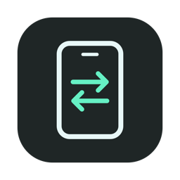
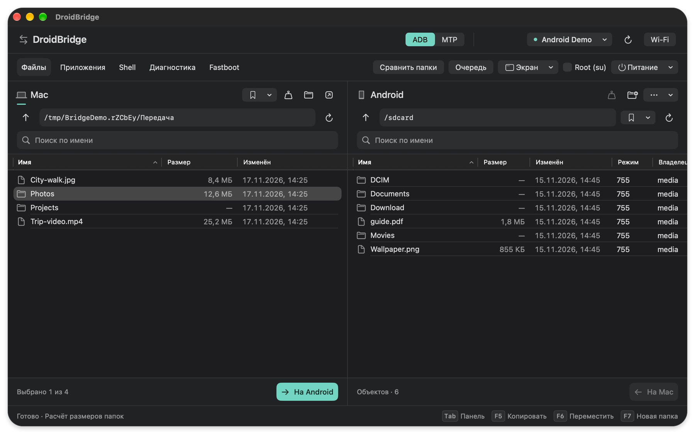
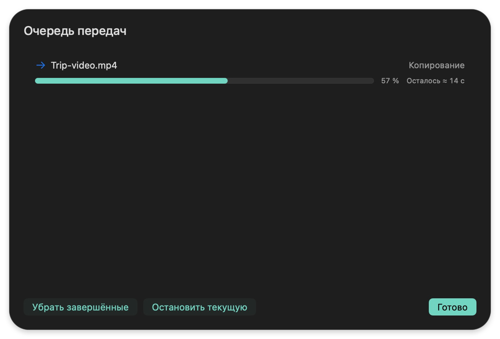
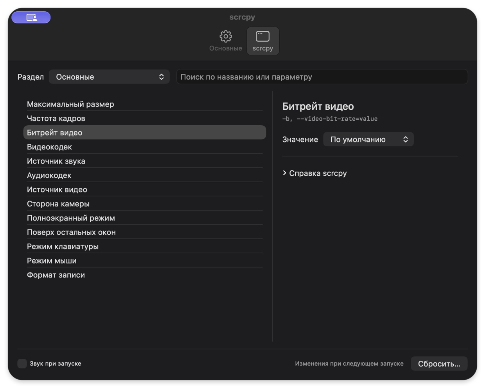

  
  <h1>DroidBridge</h1>
  
<strong>Android files, apps, and screen control on your Mac</strong>

  
<strong>English</strong> · <a href="README.ru.md">Русский</a>

  
macOS 14.4+ · Apple Silicon and Intel

  
<a href="#quick-start">Install</a> · <a href="#what-it-does">Features</a> · <a href="#how-it-was-built">Tech stack</a> · <a href="#alternatives">Alternatives</a>

   
  Mac on the left, Android on the right. The sample Photos folder shows its size after calculation.

> **App language:** DroidBridge 1.6.1 has a Russian interface. This README is available in English and Russian. The help text supplied by scrcpy appears in English.

## Why I built it

After I bought a Mac, I still worked with Android phones often. In one session I might copy files, install an APK, open a shell, and check what was happening on the phone's screen. On macOS I found tools for each part of the job. I kept switching between a file transfer app, a screen mirroring tool, and Terminal.

I wanted the workflow I knew from Total Commander: two file panes, keyboard shortcuts, and the Android tools within reach. That's how DroidBridge started. I can copy photos over MTP, then switch to ADB to install an APK and open Logcat without leaving the app.

## What it does

| Task | In DroidBridge |
| --- | --- |
| Move files | Two panes, drag and drop, sorting by name, size, and modification date, bookmarks, folder sizes on demand, folder comparison by size and date, and a transfer queue that handles name conflicts. The status bar shows the active transfer, progress, and estimated time remaining. |
| Choose a connection | Built-in USB MTP for file transfers without USB debugging. ADB over USB or Wi-Fi for files and device tools. You can also launch OpenMTP from the device menu if it is installed. |
| Manage apps and diagnose issues | Install and export APKs, launch or uninstall apps, open an ADB shell with history, filter Logcat by package, and capture screenshots or bug reports. |
| Work with the Android screen | Mirror, control, and record with scrcpy. Choose video and audio sources, codecs, frame rate, and keyboard and mouse modes. |
| Work in Fastboot | Detect USB devices in the bootloader or fastbootd, read device variables, reboot, temporarily boot a compatible image, or flash a specified partition. |
| Update the tools | Check for official ADB, Fastboot, and scrcpy updates from Settings and switch back to the bundled versions when needed. |

### Transfer queue

   
  The queue shows the active file, progress and estimated time remaining.

### scrcpy settings

   
  Choose a video bitrate, frame rate or codec from the settings window.

Open **DroidBridge → Настройки → scrcpy**. Start in **Основные** (Common), or search by name or CLI flag. Common options have menus, such as 60 fps, H.265, and MKV. Choose **По умолчанию** (Default) to let scrcpy decide or **Своё значение…** (Custom value) to enter a value. Changes apply the next time scrcpy starts.

DroidBridge reads the full option catalog from the selected version's `scrcpy --help`. Linux-only options are shown for reference. The corresponding diagnostic commands can list available displays, cameras, and encoders. Support for these features depends on the phone and its Android version.

### Fastboot and recovery

Open **Fastboot** and connect a phone in bootloader mode by USB. If the phone is already connected over ADB, use **В загрузчик через ADB** (Reboot to bootloader through ADB). Use **Читать сведения** (Read device info) to check the product, mode, bootloader lock status, and active slot when the device reports them.

- **Временно загрузить…** (Boot temporarily) runs `fastboot boot` with a compatible `.img` if the bootloader supports it.
- **Записать в раздел…** (Flash a partition) asks for an image and the partition named in the instructions for your exact device. DroidBridge checks that the device reports the partition and shows the resolved target before writing. Some devices have no separate `recovery` partition.

Use the image and instructions for your exact model. Flashing typically requires an unlocked bootloader. Fastboot ships with DroidBridge and updates together with ADB through Android SDK Platform Tools. See the [Android Fastboot and fastbootd documentation](https://source.android.com/docs/core/architecture/bootloader/fastbootd).

## Quick start

Open **Releases** on GitHub, download the DMG, and drag DroidBridge into Applications. The 1.6.1 DMG uses an ad hoc signature and has not been notarized by Apple.

| Mode | On the phone |
| --- | --- |
| **MTP** | Unlock the phone and choose **File transfer** in the USB options. If OpenMTP already holds the USB connection, quit it with **⌘Q** before using DroidBridge's built-in MTP. |
| **ADB** | Enable USB debugging in Developer options and approve the Mac on the phone. For Wi-Fi pairing, open **Wireless debugging** on the phone and use the Wi-Fi button in DroidBridge. |

DroidBridge starts its own ADB server on demand and stops it when you quit. ADB servers started by other apps keep running.

Use **Tab** to switch panes, **F5** to copy, **F6** to move, and **F7** to create a folder. To see a folder's size, select it and click the scales icon.

DroidBridge offers to install an optional Android helper for app metadata, text clipboard exchange, and launcher shortcuts. Pinning shortcuts requires Android 8 or later and a compatible launcher.

## How it was built

| Technology | What it does |
| --- | --- |
| **Swift, SwiftUI, AppKit** | Native macOS interface, file panes, menus, keyboard shortcuts, file dialogs, and clipboard integration. |
| **Foundation and CryptoKit** | Run device tools, manage downloads, and verify file hashes. |
| **C, [libmtp](https://github.com/libmtp/libmtp), and [libusb](https://github.com/libusb/libusb)** | The built-in USB MTP connection. |
| **[Android SDK Platform Tools](https://developer.android.com/tools/releases/platform-tools)** | ADB for Android files, APKs, shell commands, and diagnostics. Fastboot for bootloader and partition operations. |
| **[Genymobile scrcpy](https://github.com/Genymobile/scrcpy)** | Screen mirroring, input, audio, and recording. |
| **Java and Android SDK Build Tools** | Build the optional Android helper APK. |
| **Xcode Command Line Tools, Bash, and Python 3** | Compile and package the universal macOS app and DMG. |

Read the [build guide (Russian)](BUILD.md), [third-party credits and licensing notes (Russian)](THIRD_PARTY.md), or [v1.6.1 release notes (Russian)](docs/release-v1.6.1.md).

## Alternatives

| Tool | When to use it |
| --- | --- |
| [OpenMTP](https://github.com/ganeshrvel/openmtp) | Two-pane MTP file transfers on macOS. |
| [ADB Studio](https://www.adb-studio.app/docs) | A macOS GUI for ADB, with app management, port forwarding, and screen mirroring. |
| [scrcpy](https://github.com/Genymobile/scrcpy) | Screen mirroring, control, or recording from the command line. DroidBridge uses it under the hood. |
| [Android ADB for Total Commander](https://totalcmd.net/plugins/android_adb) | File management, APKs, shell, and logs in Total Commander on Windows. It inspired DroidBridge's workflow. |
| [Android Debug Bridge](https://developer.android.com/tools/adb) | Direct ADB commands and automation in Terminal. |

DroidBridge's advantage is the shared file workspace: the same panes, shortcuts, and transfer queue work across MTP and ADB, with APKs, Shell, Logcat, and scrcpy available in the same app.
