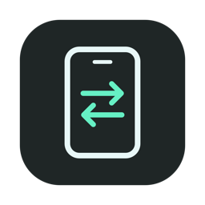
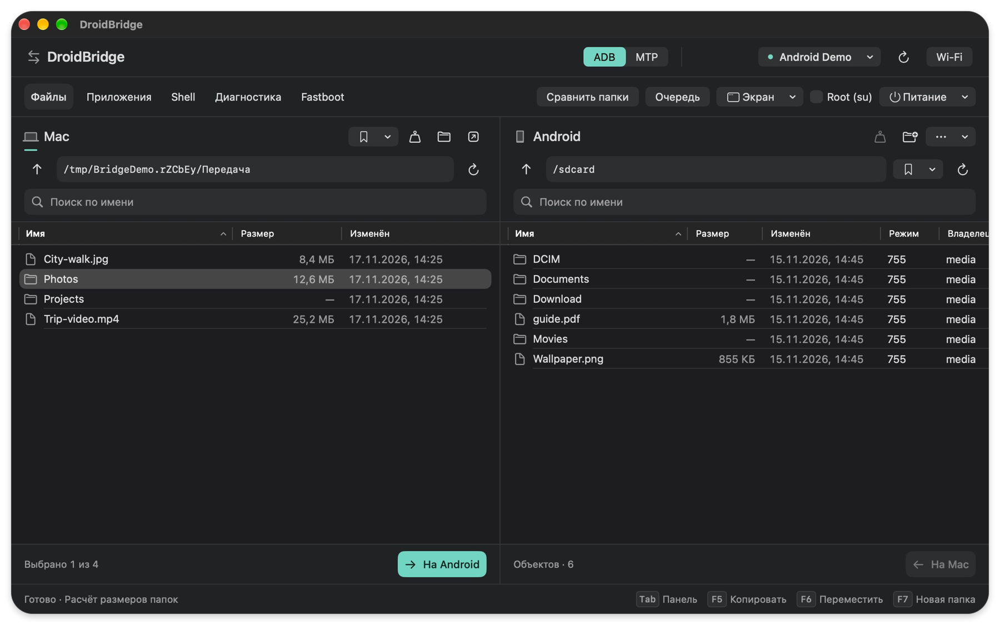
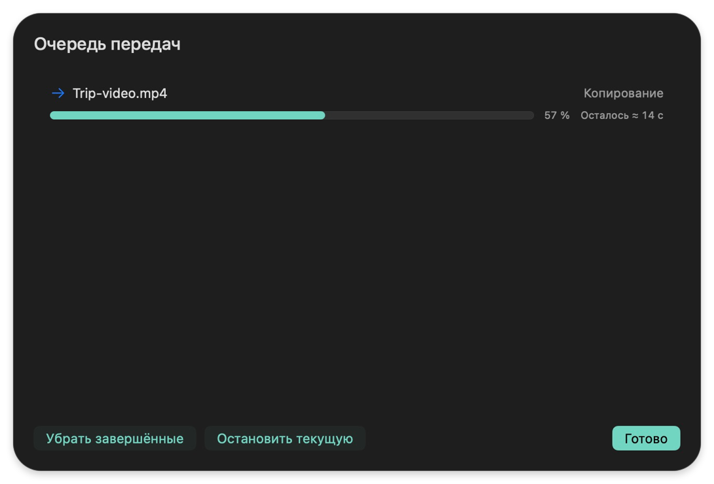
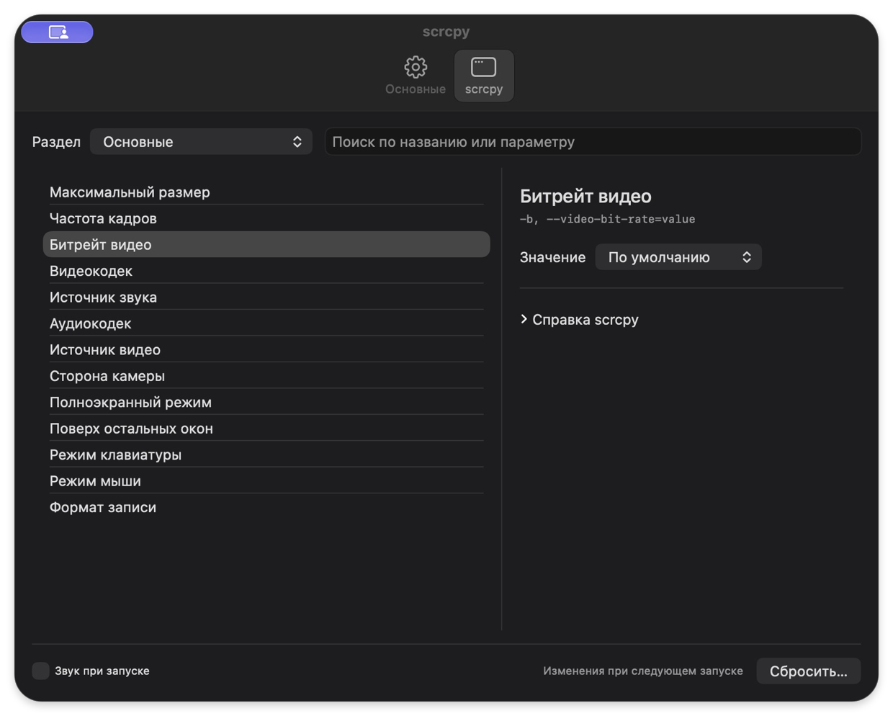

  
  <h1>DroidBridge</h1>
  
<strong>Файлы, приложения и управление экраном Android на Mac</strong>

  
<a href="README.md">English</a> · <strong>Русский</strong>

  
macOS 14.4+ · Apple Silicon и Intel

  
<a href="#быстрый-старт">Установка</a> · <a href="#возможности">Возможности</a> · <a href="#на-чём-сделано">Технологии</a> · <a href="#аналоги">Аналоги</a>

   
  Mac слева, Android справа. Для папки Photos рассчитан размер.

> **Язык приложения:** в DroidBridge 1.6.1 интерфейс на русском. README доступен на русском и английском. Встроенная справка, которую выводит scrcpy, отображается на английском.

## Как появился DroidBridge

Когда я купил Mac, мне по-прежнему нужно было часто работать с телефонами Android. За один сеанс я мог перекинуть файлы, установить APK, открыть Shell и проверить, что происходит на экране телефона. На macOS я находил инструменты для отдельных задач: для передачи файлов открывал одну программу, для экрана — другую, а за командами ADB шёл в Терминал.

Мне хотелось рабочего процесса в духе Total Commander: две панели, горячие клавиши и инструменты Android под рукой. Так появился DroidBridge. Теперь я могу скопировать фото по MTP, затем переключиться на ADB, установить APK и открыть Logcat в том же приложении.

## Возможности

| Задача | Что есть в DroidBridge |
| --- | --- |
| Работа с файлами | Две панели, перетаскивание, сортировка по имени, размеру и дате изменения, закладки, расчёт размера папок по кнопке, сравнение папок по размеру и дате, очередь передач с обработкой совпадающих имён. Внизу окна видны прогресс активной передачи и примерное оставшееся время. |
| Подключение к телефону | Встроенный USB MTP для передачи файлов без отладки. ADB по USB или Wi-Fi для файлов и управления устройством. Если OpenMTP установлен, его можно открыть из меню устройства. |
| Приложения и диагностика | Установка и экспорт APK, запуск и удаление приложений, ADB Shell с историей, Logcat с фильтром по пакету, скриншоты и отчёты Android. |
| Работа с экраном | Трансляция, управление и запись через scrcpy. Настройки видео, звука, кодеков, частоты кадров, клавиатуры и мыши. |
| Работа в Fastboot | Поиск устройств по USB в загрузчике или fastbootd, чтение переменных, перезагрузка, временная загрузка совместимого образа и запись в указанный раздел. |
| Обновление инструментов | Проверка официальных обновлений ADB, Fastboot и scrcpy в настройках и возврат к встроенным версиям. |

### Очередь передач

   
  В очереди видны имя текущего файла, прогресс и примерное оставшееся время.

### Настройки scrcpy

   
  Битрейт, частоту кадров и кодек можно выбрать в настройках приложения.

Откройте **DroidBridge → Настройки → scrcpy**. Начните с раздела **Основные** или найдите нужный параметр по названию или флагу. Для типовых настроек есть меню значений: например, 60 кадр/с, H.265 или формат записи MKV. Выберите **По умолчанию**, чтобы оставить поведение scrcpy, или **Своё значение…**, чтобы ввести значение вручную. Изменения применяются при следующем запуске scrcpy.

DroidBridge читает полный каталог параметров из `scrcpy --help` выбранной версии. Параметры только для Linux показаны справочно. Диагностические команды выводят списки доступных дисплеев, камер и кодировщиков. Поддержка зависит от устройства и версии Android.

### Fastboot и Recovery

Откройте вкладку **Fastboot** и подключите телефон по USB в режиме загрузчика. Если телефон уже подключён по ADB, нажмите **В загрузчик через ADB**. Кнопка **Читать сведения** показывает код устройства, режим, состояние блокировки загрузчика и активный слот, если устройство их сообщает.

- **Временно загрузить…** запускает `fastboot boot` с совместимым файлом `.img`, если загрузчик поддерживает команду.
- **Записать в раздел…** предлагает выбрать файл и указать раздел из инструкции к образу для вашей модели. DroidBridge проверяет, что устройство сообщает о наличии раздела, и показывает точную цель перед записью. На некоторых устройствах отдельного раздела `recovery` нет.

Для записи обычно нужен разблокированный загрузчик. Используйте образ и инструкцию для вашей модели. Fastboot входит в комплект и обновляется вместе с ADB в составе Android SDK Platform Tools. [Документация Android о Fastboot и fastbootd](https://source.android.com/docs/core/architecture/bootloader/fastbootd).

## Быстрый старт

Откройте **Releases** на GitHub, скачайте DMG и перетащите DroidBridge в «Программы». У DMG версии 1.6.1 локальная подпись ad hoc, сборка не проходила нотарификацию Apple.

| Режим | Что сделать на телефоне |
| --- | --- |
| **MTP** | Разблокируйте телефон и выберите USB-режим **Передача файлов**. Если USB уже занят OpenMTP, завершите его через **⌘Q**, чтобы использовать встроенный MTP DroidBridge. |
| **ADB** | Включите отладку по USB в настройках разработчика и подтвердите подключение к Mac на телефоне. Для подключения по Wi-Fi откройте на телефоне **Беспроводная отладка** и нажмите кнопку Wi-Fi в DroidBridge. |

DroidBridge запускает собственный сервер ADB по мере необходимости и останавливает его при выходе. Серверы ADB других приложений продолжают работать.

**Tab** переключает панель, **F5** копирует, **F6** перемещает, **F7** создаёт папку. Чтобы узнать размер папки, выделите её и нажмите кнопку с весами.

Для метаданных приложений, обмена текстом через буфер и работы с ярлыками DroidBridge предлагает установить необязательный Android-помощник. Для закрепления ярлыков нужен Android 8 или новее и совместимый лаунчер.

## На чём сделано

| Технология | За что отвечает |
| --- | --- |
| **Swift, SwiftUI, AppKit** | Нативный интерфейс macOS, файловые панели, меню, горячие клавиши, файловые диалоги и буфер обмена. |
| **Foundation и CryptoKit** | Запуск инструментов, загрузка обновлений и проверка контрольных сумм. |
| **C, [libmtp](https://github.com/libmtp/libmtp) и [libusb](https://github.com/libusb/libusb)** | Встроенное подключение по USB MTP. |
| **[Android SDK Platform Tools](https://developer.android.com/tools/releases/platform-tools)** | ADB для файлов Android, работы с APK, Shell и диагностики. Fastboot для работы с загрузчиком и разделами. |
| **[Genymobile scrcpy](https://github.com/Genymobile/scrcpy)** | Трансляция экрана, управление, звук и запись. |
| **Java и Android SDK Build Tools** | Сборка необязательного Android-помощника в виде APK. |
| **Xcode Command Line Tools, Bash и Python 3** | Сборка универсального приложения для Mac и упаковка в DMG. |

См. [инструкцию по сборке](BUILD.md), [сведения о сторонних компонентах и лицензиях](THIRD_PARTY.md) и [описание релиза 1.6.1](docs/release-v1.6.1.md).

## Аналоги

| Инструмент | Когда подходит |
| --- | --- |
| [OpenMTP](https://github.com/ganeshrvel/openmtp) | Двухпанельная передача файлов по MTP на macOS. |
| [ADB Studio](https://www.adb-studio.app/docs) | Графический интерфейс ADB для macOS с управлением приложениями, перенаправлением портов и трансляцией экрана. |
| [scrcpy](https://github.com/Genymobile/scrcpy) | Трансляция, управление и запись экрана из командной строки. DroidBridge использует его для этих задач. |
| [Android ADB для Total Commander](https://totalcmd.net/plugins/android_adb) | Файлы, APK, Shell и журналы в Total Commander на Windows. Этот подход вдохновил DroidBridge. |
| [Android Debug Bridge](https://developer.android.com/tools/adb) | Прямые команды ADB и автоматизация в Терминале. |

Преимущество DroidBridge — общий рабочий интерфейс: те же панели, горячие клавиши и очередь работают в режимах MTP и ADB, а APK, Shell, Logcat и scrcpy доступны в том же приложении.
